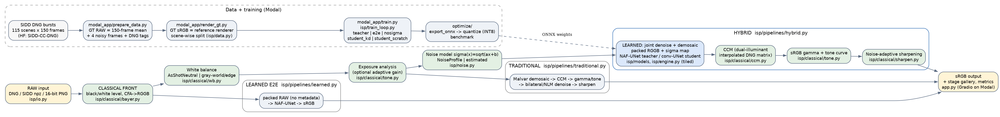
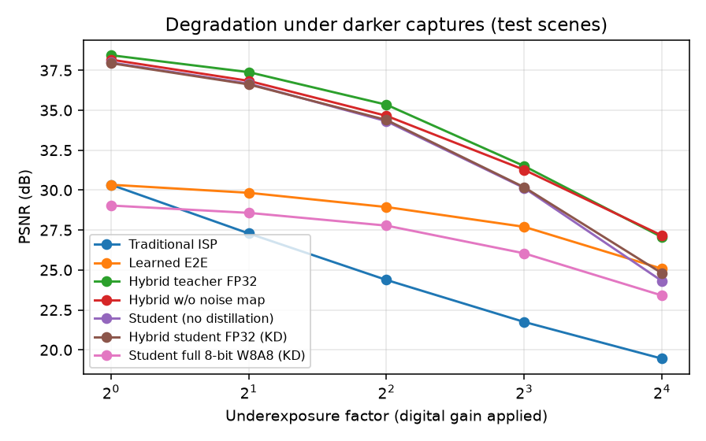

# Hybrid Smartphone ISP: RAW → sRGB (CV Hackathon 2026, Problem P2)

**Live app:** https://hemansshu-raaj--hybrid-isp.us-east.modal.run

A smartphone image signal processor that turns noisy Bayer RAW into a finished sRGB photo. Classical camera stages do
the jobs they are good at and that depend on camera metadata: black level, white balance, noise model, colour matrix
and tone curve. A small neural network does the job classical methods do poorly: **joint denoising + demosaicing**,
conditioned on a per-pixel noise map. We compare it with a **traditional ISP** and a **fully learned ISP**.



## Results (test split: 26 captures of 2 scenes never seen in training, 832 crops)

| Pipeline | PSNR ↑ | SSIM ↑ | ΔE2000 ↓ | LPIPS ↓ | Params | Size | Full pipeline, CPU ms / MP (2 threads) |
|---|---|---|---|---|---|---|---|
| Traditional ISP | 28.03 | 0.674 | 5.83 | 0.459 | – | – | 305 |
| Learned end-to-end | 29.43 | 0.877 | 6.77 | 0.286 | 2.65 M | 10.8 MB | 2697 |
| **Hybrid teacher** | **34.91** | **0.895** | **2.44** | **0.236** | 2.65 M | 10.8 MB | 2753 |
| Hybrid student, INT8 weights / 16-bit activations (**deployed**) | 34.54 | 0.890 | 2.57 | 0.249 | 0.63 M | **0.71 MB** | 637 |

- Hybrid vs traditional: **+6.9 dB, ΔE 5.83 → 2.44.** Hybrid vs the same network trained end-to-end: **+5.5 dB.**
- Deployed model: **15× smaller** than the teacher, −0.37 dB.
- Robust across ISO 100 to 10,000, low and normal light, all 5 phones, and 16× underexposure (27.1 dB vs 19.5 traditional).

Full tables: [`eval_P2_T77.md`](eval_P2_T77.md). Ablations and failure cases: [`docs/ablation_failures.md`](docs/ablation_failures.md).
Design: [`docs/design_doc.md`](docs/design_doc.md).



## Quick start

```bash
make setup        # Python 3.12 venv (uv) + all dependencies
make test         # unit tests
make app          # web app on http://localhost:7860 (uses weights/*.onnx)
make docker       # same app in Docker:  docker build -t hybrid-isp . && docker run -p 7860:7860 hybrid-isp
```

The app accepts phone **DNG** files (Android Pro/RAW mode; Pixel, OnePlus, Xiaomi, Samsung and others), our SIDD
`.npz` crops (which include ground truth, so the app shows metrics), and 16-bit Bayer PNGs.

## Reproducing the results

Training and evaluation run on [Modal](https://modal.com) (`modal token new` once).

```bash
make data         # download SIDD DNG bursts, build GT (150-frame average), render GT sRGB, traditional baseline
make train        # teacher, e2e, nosigma, student_kd, student_scratch on A10 GPUs
make weights      # export to ONNX + INT8 quantisation  (copy checkpoints to runs/ckpt/*.pt first)
make benchmark    # size / latency / memory
make eval         # full test-split evaluation -> eval_P2_T77.md
```

## Repository map

| Path | What it does |
|---|---|
| `isp/io.py` | RAW loading (rawpy + DNG tags via exifread), CFA → RGGB, friendly input errors |
| `isp/classical/` | white balance, demosaic, CCM (dual-illuminant interpolation), gamma/tone, denoise, sharpening, torch copy of the tail |
| `isp/noise.py` | Poisson-Gaussian noise model: DNG NoiseProfile or estimated from the image |
| `isp/models/` | NAF-UNet (teacher / end-to-end), plain conv U-Net (student) |
| `isp/pipelines/` | `traditional.py`, `learned.py`, `hybrid.py`: the three ISPs compared |
| `isp/engine.py` | tiled inference with PyTorch or ONNX Runtime |
| `isp/train_loop.py`, `isp/train_data.py` | training (Charbonnier loss in sRGB through the classical tail, distillation) |
| `modal_app/` | dataset build, GT rendering, training, hosting on Modal |
| `optimize/` | ONNX export, INT8 quantisation, benchmark |
| `eval/` | evaluation, ablations, app examples |
| `docs/` | architecture diagram, design document, ablation + failure analysis |

## Data

SIDD (Abdelhamed et al., CVPR 2018), original DNG bursts as redistributed in `MhdMohammadi/SIDD-CC-DNG`
(115 captures × 150 frames, 5 phones, ISO 50 to 10,000). Ground-truth RAW is the mean of the 150 frames, with
brightness outliers removed. Ground-truth sRGB is rendered from it by our reference renderer. **The split is by
physical scene:** scenes 003 and 007 are test, 008 is validation and the rest are training (`splits/splits.json`).
No test content is seen in training.

## Limitations and ethics

_Expanded in `docs/design_doc.md`._ The ground truth is rendered by a fixed classical renderer, so "quality" means
fidelity to that rendering, not a phone maker's aesthetic. Training covers 5 (older) phones, and colour on unseen
sensors relies on DNG metadata. Uploaded images are processed in memory and not stored. Datasets: SIDD (MIT); the
tone curve comes from simple-camera-pipeline (MIT), see `third_party/`.
