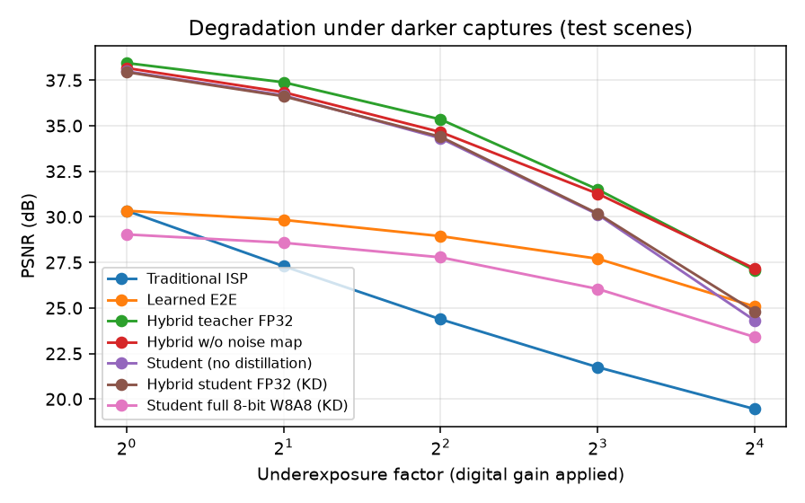
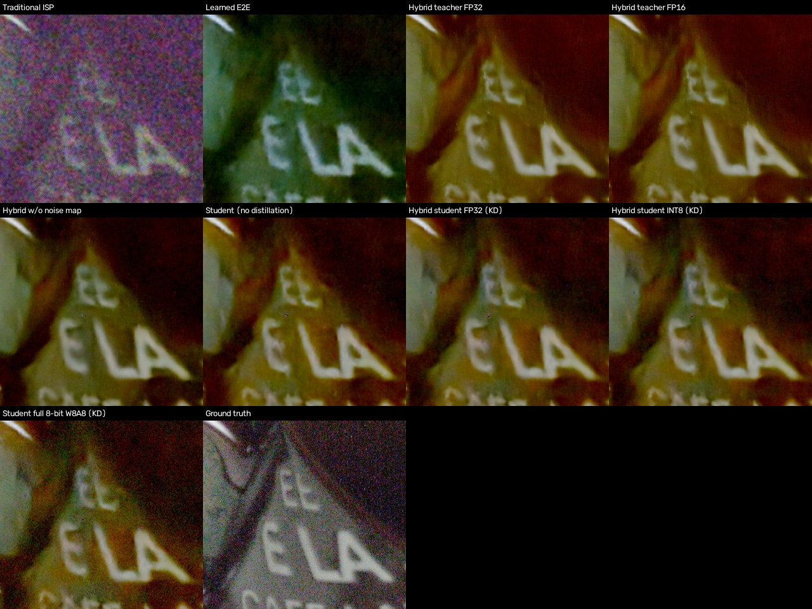
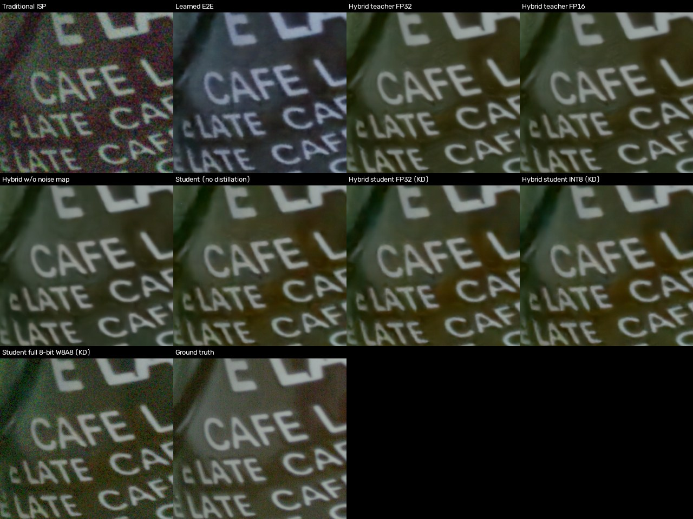

1RUA24CSE0162,1RUA24CSE0150,1RUA24CSE0187,1RUA24CSE0167

# Evaluation: P2 Intelligent and Computationally Efficient Smartphone ISP (Team T77)

**Test set:** 26 SIDD captures of 2 physical scenes (003, 007) never seen in training; 5 phones, ISO 100 to 10,000, low and normal light. 832 seeded 512×512 crops (32 per capture) of a single noisy frame. Ground truth = 150-frame average rendered by the reference ISP.

## 1. Main results (metrics in the order of the problem statement)

| Pipeline | PSNR (dB) ↑ | SSIM ↑ | ΔE2000 ↓ | LPIPS ↓ | Params (M) | Model size (MB) | CPU latency, 1 MP, 2 threads (ms) | Peak CPU memory (MB) | GPU latency, 1 MP, A10 (ms) |
|---|---|---|---|---|---|---|---|---|---|
| Traditional ISP | 28.03 | 0.6741 | 5.83 | 0.4594 | 0 (classical) | – | – | – | – |
| Learned E2E | 29.43 | 0.8765 | 6.77 | 0.2862 | 2.653 | 10.76 | 2259 | 390 | 25.5 |
| Hybrid teacher FP32 | 34.91 | 0.8945 | 2.44 | 0.2361 | 2.653 | 10.76 | 2728 | 398 | 25.7 |
| Hybrid teacher FP16 | 34.91 | 0.8945 | 2.44 | 0.2361 | 2.653 | 5.38 | – | – | 14.0 |
| Hybrid w/o noise map | 34.78 | 0.8933 | 2.45 | 0.2444 | 2.652 | – | – | – | – |
| Student (no distillation) | 34.52 | 0.8911 | 2.59 | 0.2460 | 0.630 | – | – | – | 3.6 |
| Hybrid student FP32 (KD) | 34.56 | 0.8911 | 2.56 | 0.2504 | 0.630 | 2.53 | 365 | 171 | 3.6 |
| Hybrid student INT8 (KD) | 34.54 | 0.8903 | 2.57 | 0.2489 | 0.630 | 0.71 | 527 | 173 | – |
| Student full 8-bit W8A8 (KD) | 27.72 | 0.5844 | 7.90 | 0.3980 | 0.630 | 0.71 | 216 | 164 | – |

Traditional ISP CPU time: 92 ms per 512×512 crop (whole pipeline, numpy/OpenCV). Network latencies are for the network stage only; the classical stages add the same cost to every hybrid variant.

## 2. Robustness by noise level (ISO)

| Group | Traditional ISP PSNR / ΔE | Learned E2E PSNR / ΔE | Hybrid teacher FP32 PSNR / ΔE | Hybrid student INT8 (KD) PSNR / ΔE |
|---|---|---|---|---|
| ISO 800–1600 | 26.47 / 6.86 | 29.48 / 6.92 | 35.02 / 2.62 | 34.64 / 2.78 |
| ISO ≤ 400 | 30.59 / 4.10 | 30.02 / 6.41 | 35.83 / 1.92 | 35.48 / 2.02 |
| ISO ≥ 3200 | 22.14 / 9.88 | 26.69 / 7.84 | 30.55 / 4.07 | 30.11 / 4.30 |

## 3. Robustness by illumination (SIDD brightness code)

| Group | Traditional ISP PSNR / ΔE | Learned E2E PSNR / ΔE | Hybrid teacher FP32 PSNR / ΔE | Hybrid student INT8 (KD) PSNR / ΔE |
|---|---|---|---|---|
| low | 28.06 / 6.45 | 29.30 / 7.11 | 34.44 / 2.74 | 34.09 / 2.88 |
| normal | 28.01 / 5.44 | 29.51 / 6.56 | 35.20 / 2.25 | 34.82 / 2.38 |

## 4. Robustness by phone (sensor)

| Group | Traditional ISP PSNR / ΔE | Learned E2E PSNR / ΔE | Hybrid teacher FP32 PSNR / ΔE | Hybrid student INT8 (KD) PSNR / ΔE |
|---|---|---|---|---|
| G4 | 27.09 / 6.51 | 27.05 / 9.16 | 31.38 / 3.36 | 30.97 / 3.56 |
| GP | 28.65 / 4.74 | 30.01 / 5.69 | 35.21 / 2.38 | 34.68 / 2.54 |
| IP | 29.06 / 6.35 | 30.64 / 6.02 | 37.53 / 2.20 | 37.12 / 2.33 |
| N6 | 25.71 / 5.75 | 28.16 / 7.89 | 31.94 / 2.43 | 31.82 / 2.53 |
| S6 | 27.45 / 4.95 | 26.15 / 8.74 | 29.68 / 2.63 | 29.62 / 2.69 |

## 5. Degradation sweep: darker captures (clean RAW × exposure, real noise model, digital gain back)

| Pipeline | ×1 PSNR | ×0.5 PSNR | ×0.25 PSNR | ×0.125 PSNR | ×0.0625 PSNR |
|---|---|---|---|---|---|
| Traditional ISP | 30.34 | 27.29 | 24.38 | 21.75 | 19.45 |
| Learned E2E | 30.34 | 29.83 | 28.94 | 27.70 | 25.08 |
| Hybrid teacher FP32 | 38.44 | 37.38 | 35.35 | 31.50 | 27.06 |
| Hybrid w/o noise map | 38.17 | 36.84 | 34.65 | 31.27 | 27.16 |
| Student (no distillation) | 37.99 | 36.66 | 34.31 | 30.13 | 24.31 |
| Hybrid student FP32 (KD) | 37.94 | 36.62 | 34.39 | 30.18 | 24.80 |
| Student full 8-bit W8A8 (KD) | 29.03 | 28.58 | 27.78 | 26.04 | 23.40 |

## 6. Ablation study

**Inference-time ablations on the hybrid teacher** (16 crops per capture):

| Variant | PSNR (dB) | SSIM | ΔE2000 | Δ PSNR vs full |
|---|---|---|---|---|
| full (metadata WB + NoiseProfile) | 34.90 | 0.8969 | 2.42 | +0.00 |
| WB: gray-world instead of metadata | 29.08 | 0.8908 | 6.77 | -5.82 |
| WB: gray-edge instead of metadata | 28.81 | 0.8897 | 7.61 | -6.09 |
| CCM off (camera RGB shown as sRGB) | 32.75 | 0.8950 | 3.42 | -2.15 |
| noise model estimated from image | 34.74 | 0.8956 | 2.43 | -0.16 |
| noise map x0 (network told: no noise) | 33.76 | 0.8798 | 2.97 | -1.14 |
| noise map x2 (network told: 2x noise) | 33.33 | 0.8848 | 3.13 | -1.56 |
| + adaptive sharpening | 34.88 | 0.8966 | 2.42 | -0.02 |

**Retrained / component ablations** (full test set):

| Comparison | A | B | Δ PSNR (A − B) | Δ ΔE (A − B) |
|---|---|---|---|---|
| Hybrid vs fully learned (same network, same size) | Hybrid teacher FP32 | Learned E2E | +5.48 | -4.33 |
| Hybrid vs traditional ISP | Hybrid teacher FP32 | Traditional ISP | +6.88 | -3.39 |
| Noise-map conditioning (with vs without) | Hybrid teacher FP32 | Hybrid w/o noise map | +0.13 | -0.01 |
| Knowledge distillation (KD vs from scratch) | Hybrid student FP32 (KD) | Student (no distillation) | +0.04 | -0.03 |
| INT8 weights + 16-bit activations (W8A16) vs FP32 | Hybrid student INT8 (KD) | Hybrid student FP32 (KD) | -0.02 | +0.01 |
| Full 8-bit (W8A8) vs FP32 | Student full 8-bit W8A8 (KD) | Hybrid student FP32 (KD) | -6.84 | +5.34 |
| FP16 inference (FP16 vs FP32) | Hybrid teacher FP16 | Hybrid teacher FP32 | -0.00 | +0.00 |
| Compression total (student INT8 vs teacher) | Hybrid student INT8 (KD) | Hybrid teacher FP32 | -0.37 | +0.14 |

## 7. Failure cases (lowest-PSNR crops of the hybrid teacher)

1. **0065_003_GP_10000_08460_4400_N** (GP, ISO 10000, normal light): teacher PSNR 15.01 dB. 
2. **0054_003_N6_00100_00160_5500_N** (N6, ISO 100, normal light): teacher PSNR 23.25 dB. 
3. **0055_003_N6_00800_01000_5500_N** (N6, ISO 800, normal light): teacher PSNR 24.09 dB. 
